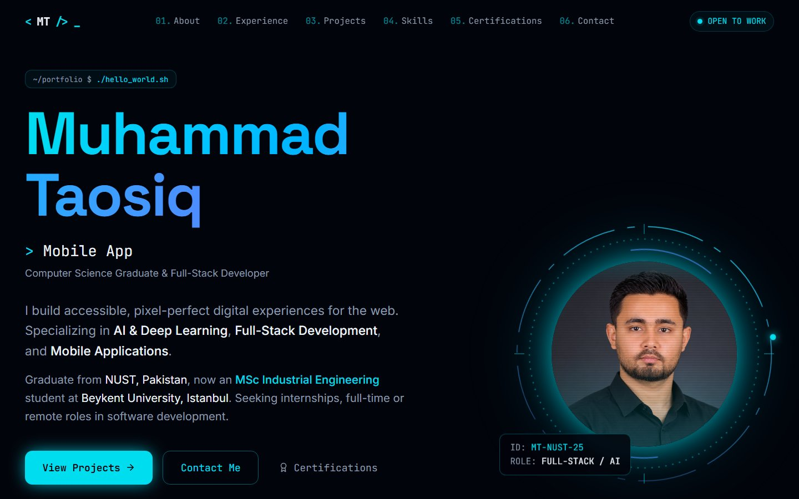

# Muhammad Taosiq: Portfolio

My personal portfolio website. I'm a Computer Science graduate from NUST and an MSc Industrial Engineering student at Beykent University, Istanbul, working on full-stack development and AI.

**Live site: [muhammad-taosiq-portfolio.vercel.app](https://muhammad-taosiq-portfolio.vercel.app)**



## Features

- **Launch intro:** a 3D-tilted code window types `npm run launch` in its terminal, turns into a browser preview of the site, then straightens out and zooms into the real page. It plays once per visit and can be skipped with a button, Enter or Esc.
- **Interactive background:** a canvas "neural network" of drifting nodes that connect to each other and reach toward the cursor, over an animated grid.
- **Text effects:**
  - Headings and the name "decrypt" from random symbols into place.
  - The role line types itself and rotates through several titles.
- **HUD portrait:** rotating rings, an orbiting node and a scan line around the profile photo.
- **Interactive cards:**
  - Glass cards with a spotlight that follows the cursor, a slight 3D tilt and corner brackets.
  - The featured project has an animated gradient border.
- **Section touches:**
  - Experience has a timeline that fills as you scroll.
  - Skills has two scrolling tech tickers.
  - Contact is a terminal-style window with a copy-email button.
- **Accessible:**
  - Respects the system's *reduce motion* setting.
  - Decrypting text stays readable to screen readers and search engines.
  - Pages are fully static.

All animations are written from scratch with CSS, Canvas and React. No animation library is used.

## Tech stack

| | |
|---|---|
| Framework | [Next.js 16](https://nextjs.org) (App Router, statically rendered) and React 19 |
| Language | TypeScript |
| Styling | Tailwind CSS v4 with custom CSS animations |
| UI | shadcn/ui components and lucide-react icons |
| Fonts | Space Grotesk, Inter and JetBrains Mono (via `next/font`) |
| Hosting | Vercel, with Vercel Analytics |

## Project structure

```
app/
  layout.tsx        fonts, metadata, global effects (intro, background, cursor)
  page.tsx          the page: all sections in order
  globals.css       theme colours, keyframes and effect utilities
components/
  hero.tsx, about.tsx, experience.tsx, projects.tsx,
  skills.tsx, certifications.tsx, contact.tsx, navigation.tsx, footer.tsx
  fx/               reusable effects: intro, neural background, scramble text,
                    typewriter, holo card, scroll reveal, cursor, scroll progress
lib/
  content.ts        ALL site text: profile, experience, projects, skills, certificates, contact
  motion.ts         animation helpers (reduced motion, intro timing)
public/             profile photo, certificate images, icons
```

### Updating the content

All the text on the site lives in **[`lib/content.ts`](lib/content.ts)**. To add a project, job or certificate, copy an existing entry in that file and edit it. The components pick up changes automatically.

## Running locally

You need **Node.js 20.9+**. The project uses **pnpm**; `npx pnpm@9` works if pnpm isn't installed.

```bash
pnpm install     # install dependencies
pnpm dev         # start the dev server at http://localhost:3000
pnpm build       # production build
pnpm start       # serve the production build
```

The intro plays once per browser session. Open the site in a private window to see it again.

## Deployment

The site deploys automatically on **Vercel**: every push to `main` builds and goes live in about a minute. There are no environment variables to configure.

## Contact

- **LinkedIn:** [linkedin.com/in/mtaosiq](https://www.linkedin.com/in/mtaosiq)
- **GitHub:** [github.com/taosiq](https://github.com/taosiq)
- **Email:** taosiqmuhammad@gmail.com

---

© Muhammad Taosiq. All rights reserved. The code is shared for reference, but please don't reuse the personal content (photos, text, certificates).
